<a href="https://astrosynx.org/">
  
</a>

  
  
  
  
  

Astrosynx turns physical infrastructure into productive compute. We started in 2017 with Bitcoin mining. Since then the same team, running the same hardware discipline, has taken on GPU compute, colocation and proof-of-stake validation.

 

## Infrastructure

<a href="https://astrosynx.org/#bitcoin">
  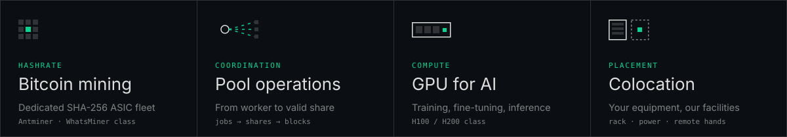
</a>

The work covers power planning, airflow, firmware and fleet maintenance. GPU projects run in isolated environments, and colocated hardware gets site planning, installation, remote hands and lifecycle tracking.

 

## A hardware-first history

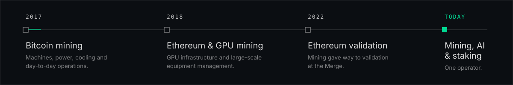

 

## Proof of stake

The workload changed but the discipline did not. The monitoring, maintenance and key security we use for the mining fleet also run our validators.

  <a href="https://www.mintscan.io/celestia/validators/celestiavaloper1mhqqnzfjfpch7ljk33ds97mjjzps79d9z8lf29">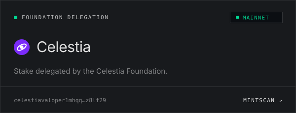</a>
  <a href="https://monadvision.com/validator/0xCcDAB988873Ef830fa0C341812c2a860C5823A70">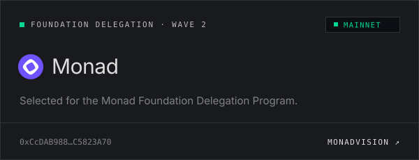</a>

Our other networks:

  <a href="https://beaconscan.com/validator/0xa6b25afbbe615eeb9e03a37b407bbbfef691e6a714db8be74bec336cc95802e174d21773a0e7f61ebd0938bbcbc756d4">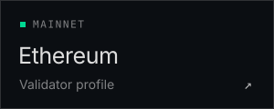</a>
  <a href="https://testnet.monad-watchtower.xyz/validator/0x03ff32929b69599c9e276e05c3bfb3d4d21c770d7cf19b4cd2e88d00c1860e3787">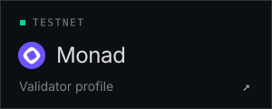</a>
  <a href="https://testnet.celestia.explorers.guru/validator/celestiavaloper1sfc6ld7mt0xf5s6p4pfslwn5fes7tce6240scs">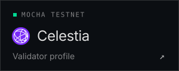</a>
  <a href="https://voyager.online/staking?validator=0x02345dfe6a1cac32e9e5c48c47e104281bc766ecdee47cdeeab6028ade7fc003">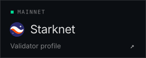</a>
  <a href="https://dymension.explorers.guru/validator/dymvaloper1lhh9xf0wecpkes7marmcfvhujel7ze8raf95pz">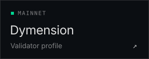</a>
  <a href="https://nibiru.explorers.guru/validator/nibivaloper1ph38gmgeq58vfcndln9ftdc549fqt3c48hadmw">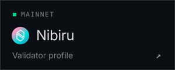</a>
  <a href="https://explorer.stavr.tech/Realio-Mainnet/staking/realiovaloper1pf74jj4n6wshp4j29dk42jc8afvf2tjta6a29w">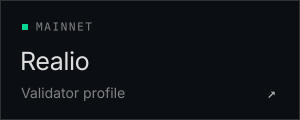</a>

 

## Operator resources

These are public tools we built for the networks we run on.

<table>
  <tr><td><a href="https://astrosynx.org/decentralization-celestia"><b>Celestia Resilience Observatory</b></a></td><td>Celestia node map and resilience simulator. Shows the Nakamoto coefficient, stake, ASN and geography.</td></tr>
  <tr><td><a href="https://astrosynx.org/decentralization-monad"><b>Monad Network Health</b></a></td><td>Monad validator map and network health.</td></tr>
  <tr><td><a href="https://astrosynx.org/readiness/"><b>Monad Readiness Kit</b></a></td><td>A read-only preflight check to run on your own node before an upgrade. Single Python file, <code>--json</code> output for CI.</td></tr>
  <tr><td><a href="https://astrosynx.org/tech"><b>Operator hub</b></a></td><td>Endpoints, snapshots and copy-paste recipes for Celestia, Ethereum, Monad, Polkadot and Story.</td></tr>
  <tr><td><a href="https://github.com/astrosynx/Celestia-Tools"><b>Celestia-Tools</b></a></td><td>Celestia endpoints, snapshots and state sync, plus a guide to <a href="https://github.com/astrosynx/Celestia-Tools/tree/main/fibre">running Fibre on a separate host</a> with a private VLAN and mTLS.</td></tr>
</table>

 

<a href="mailto:astrosynxmining@gmail.com">
  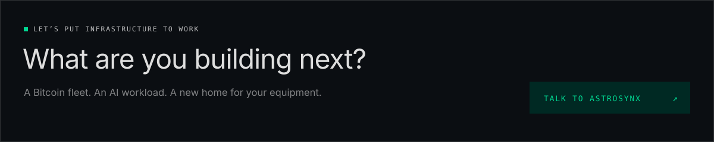
</a>

